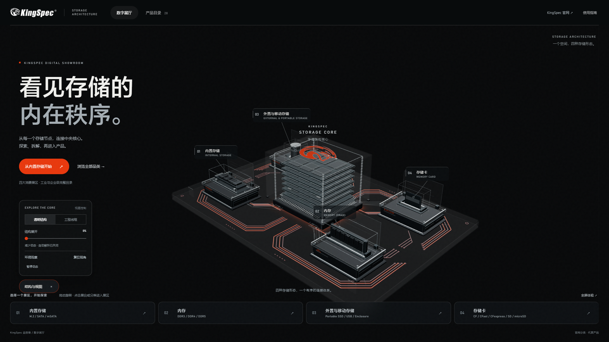
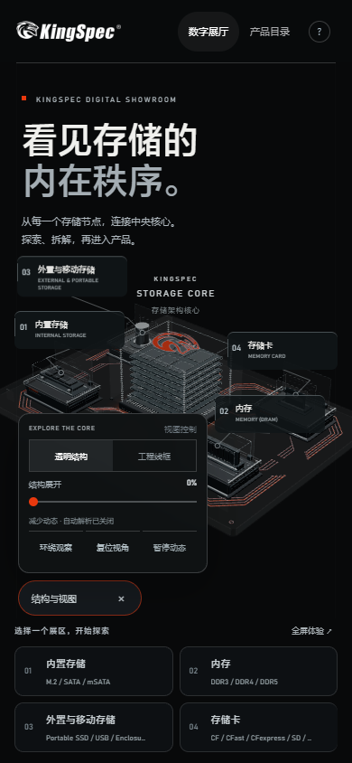

# KingSpec Digital Showroom

**KingSpec 金胜维数字展厅 / Storage Architecture**

以“看见存储的内在秩序”为主题的交互式存储产品展厅。通过三维展台进入产品分类，查看真实产品图片、容量选项、技术参数、官方来源，并比较同类产品。

## 在线体验与源码

- 在线地址：[打开数字展厅](https://zhoulianhui0602-collab.github.io/KingSpec-Digital-Showroom-Public/)
- 公开仓库：[KingSpec-Digital-Showroom-Public](https://github.com/zhoulianhui0602-collab/KingSpec-Digital-Showroom-Public)

仓库已公开建立，Pages 正在首次部署；部署结果以仓库 Actions 记录和实际访问为准。网站部署成功后，访客无需 GitHub 账号即可访问，无需保持开发电脑开机。



<details><summary>查看移动端展厅</summary>



</details>

## 当前基线

- 应用版本：**V2.1.3**，叠加 **2026-10-15** 已接受的视觉与内容增量；未另立新版本号。
- 四个三维消费展区：内置存储、内存、外置与移动存储、存储卡。
- 完整目录覆盖消费、工业、企业级 **26 个子分类**，收录 **28 款代表产品**；这些数字不表示已收录官网全部型号。
- 六层存储核心、玻璃罩与夹层基座、实体 PCB 橙色流光、HDR 反射、细框展台，以及顶盖龙头标志。
- 默认展开的视图控制、透明结构 / 工程线框、结构展开、环绕观察、暂停动态与持续显示的展区标注。
- 产品分类、详情、容量选择、来源链接和同子类最多三款比较。

这份公开基线来自 `KingSpec-Source-20261015`。同批 Complete / Source / Preview 的 `index.html` 原始 SHA-256 均为：

```text
AF52DE685288C2DF8641E6F5C600D52FD2DBD3EBB53BF92250890FAC6ED806A4
```

它用于识别接受的原始页面，不能代替后续构建与发布检查。Git 文本行尾归一化可能改变文件字节，不应为旧哈希撤销正常 LF 规则。

## Windows / macOS 本地运行

需要 Git 和 Node.js **24.18.0**（见 `.nvmrc`）。Windows 和 macOS 应分别安装依赖，不复制 `node_modules`。

在 PowerShell 或 macOS Terminal 中执行：

```sh
git clone https://github.com/zhoulianhui0602-collab/KingSpec-Digital-Showroom-Public.git
cd KingSpec-Digital-Showroom-Public

# 直接运行已构建页面，不需要安装 npm 依赖
node preview-server.cjs
```

浏览器打开 **http://127.0.0.1:4173/**。按 `Ctrl+C` 停止服务。macOS 需要手动打开地址；Windows 也可以手动打开。若使用 nvm，可在项目根目录执行 `nvm install`、`nvm use`；未安装 nvm 时直接安装 `.nvmrc` 指定的 Node.js 版本即可。

## 修改与构建

在项目根目录运行：

```sh
# 按 lockfile 安装依赖，不升级版本
npm ci --prefix source

# 从源码重新生成根目录 index.html
npm run build --prefix source

# 启动相同的本地预览服务
npm start --prefix source
```

没有 `npm run dev` 或热更新服务。修改源码后重新 build，再刷新网页。`npm start` 在 Windows 尝试打开浏览器，在其他平台打印预览地址。

技术栈：原生 HTML / CSS / JavaScript、**Three.js 0.180.0**、WebGL、OrbitControls、GLTFLoader、**esbuild 0.25.10**，以及 Node.js 原生 HTTP 预览服务。正式网页构建不需要 Blender。

## 目录说明

| 路径 | 用途 |
| --- | --- |
| `source/app.js`、`style.css`、`template.html` | 场景、交互、样式与页面模板 |
| `source/product-browser.js`、`categories.js`、`comparison.js` | 分类、产品详情与比较 |
| `source/products.json`、`storage-architecture.json` | 产品资料与核心结构数据 |
| `source/surface-finish.*`、`studio-environment.js`、`core-base-light.js` | 材质、反射环境与已有光效 |
| `source/assets/` | 构建需要的产品图片、品牌图形与 HDR |
| `source/build.cjs`、`package.json`、`package-lock.json` | 构建脚本与锁定依赖 |
| `models/kingspec-showroom.glb` | 当前主展厅模型输入 |
| `index.html` | 正式构建产物，内嵌脚本、模型、图片和 HDR；请修改源码后构建 |
| `desktop.html`、`mobile.html` | 辅助预览入口，核心体验仍由同一响应式页面提供 |
| `preview-server.cjs` | 仅绑定本机的开发预览服务 |
| `licenses/`、`LICENSE`、`ASSET_NOTICE.md` | 代码与素材授权范围说明 |

这是面向公开发布的最小源码仓库。内部评审资料、旧截图合集、PPT、旧 Git 历史、Blender 制作工程与备用测试设备资料不属于本仓库的日常构建依赖；原始完整交付应另行保留。

## 静态部署

当前主展厅是静态网站，不需要业务后端、数据库、API Key 或访问者登录。GitHub Pages 应只部署 `index.html`、辅助 HTML 入口与许可说明。不要把本地预览服务、内部资料、`.git` 或源码工作目录直接映射为公共服务器目录。

推送到 `main` 后，`.github/workflows/pages.yml` 使用锁定依赖重新构建，确认 `index.html` 与提交内容一致，再通过 GitHub Pages 部署。`source/scripts/prepare-pages.cjs` 只将网页入口与许可文件复制到 `_site/`；此目录是自动生成的部署文件夹，不提交 Git。

## 性能与验证边界

- 接受的自包含 `index.html` 约 **14.3 MB**（十进制、未压缩），首访需要下载并解码内嵌模型、图片与 HDR；实际传输量取决于托管压缩与缓存。
- 三维场景需要浏览器 WebGL 支持。高分辨率、玻璃透射与桌面后期处理增加 GPU 负担；页面内可以暂停动态或切换工程线框。
- 桌面与移动端共用响应式页面。当前目录保留的是接受的画面，发布本身不代表完成真实手机、Safari 或长期 GPU 稳定性验收。
- 历史阶段截图与性能采样不等于当前发布版本的实测结果。请以单独记录的本轮发布核验为准，不宣称所有设备稳定 60 FPS。

## 许可

本项目原创应用代码与构建脚本采用 [MIT License](LICENSE)。**品牌标志、产品图片、产品资料、HDR、GLB 和其他设计素材不包含在该代码许可中。** 三方代码保留各自许可。

特别是现有 HDR 的外部作者与许可尚未在项目中记录，它也内嵌于构建页面；公开可访问不表示该素材已获开源再许可。使用、修改或再分发素材前，请阅读 [素材与第三方声明](ASSET_NOTICE.md)，并取得相应权利人的授权。

产品参数以各产品页面列出的官方来源及适用容量为准。项目不将品牌展台陈列关系视为每款产品的子品牌归属。
